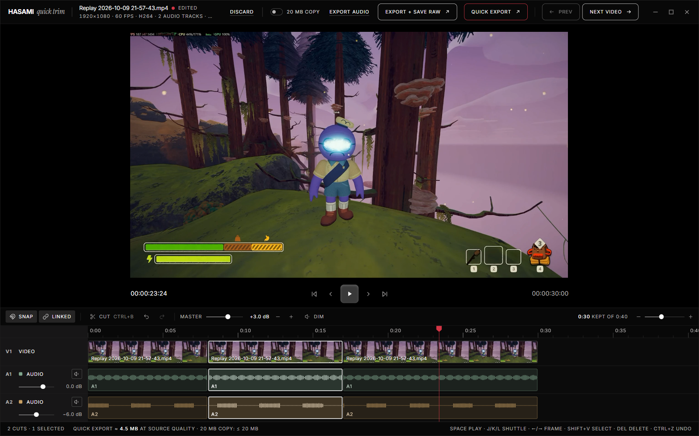
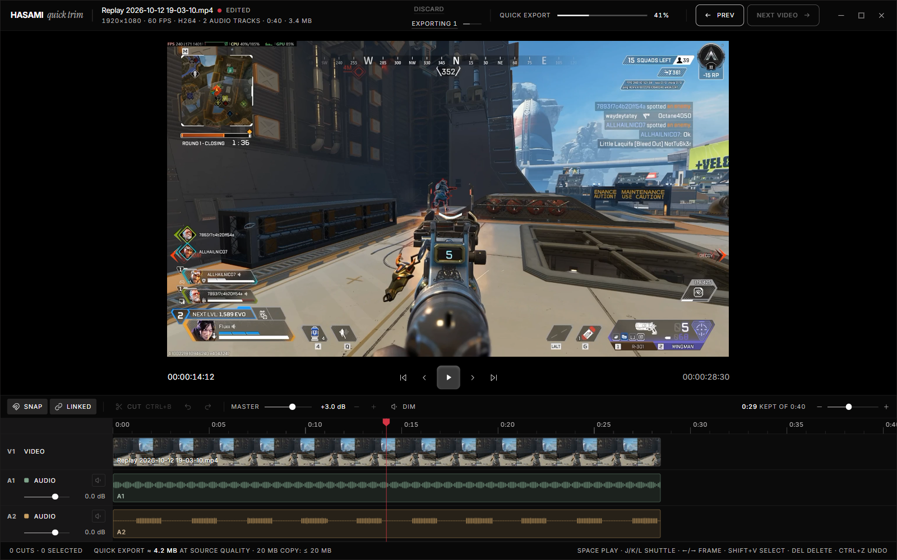
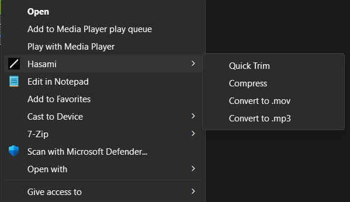
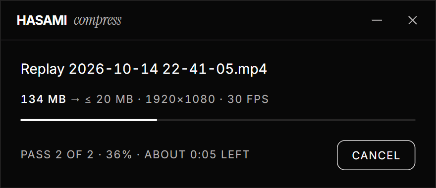

<h1 align="center">Hasami</h1>

<p align="center">
  Trim, compress and convert videos straight from Explorer's right-click menu.
</p>

<p align="center">
  <a href="https://github.com/FluxxDB/hasami/releases/latest"></a>
  <a href="#license"></a>
</p>

<p align="center">
  
</p>

Hasami (はさみ, "scissors") is a small Windows app for `.mp4`, `.mov`, `.mkv` and
`.webm` files. Right-click a clip, pick **Hasami ▸**, and it does the job without
opening an editor you have to learn.

## What it does

- **Quick Trim:** a DaVinci-like trim editor with per-track volume, master volume and Dim, that exports a Discord-safe H.264 `.mp4`, removes black borders, and can save a 20 MB copy.
- **Compress:** writes a `[20MB]` copy of the video, always 20 MB or less, to your Videos folder and keeps the original.
- **Convert:** to `.mp4`, `.mov` or `.mp3`, remuxing without re-encoding when it can. The original goes to the Recycle Bin only after the new file checks out.

<table>
  <tr>
    <td width="50%"></td>
    <td width="25%"></td>
    <td width="25%"></td>
  </tr>
  <tr>
    <td align="center">Exporting from the editor</td>
    <td align="center">The right-click menu</td>
    <td align="center">Compress progress</td>
  </tr>
</table>

Hasami never permanently deletes a file. Every output is written to a temp file,
checked with ffprobe, and only then put in place; replaced originals go to the Recycle Bin.

## Install

1. Download `Hasami_<version>_x64-setup.exe` from [Releases](https://github.com/FluxxDB/hasami/releases/latest).
2. Run it. It installs for your user only, with no admin prompt.
3. The installer isn't code-signed yet, so SmartScreen may warn you: click **More info → Run anyway**.

Then right-click a video. On Windows 11 the entries are under **Show more options → Hasami**.
Uninstalling from Settings › Apps removes the menu entries too.

Hasami is built for Windows 11 x64 (Windows 10 should work) and runs on the WebView2 runtime that ships with Windows.

## Editor shortcuts

The keys follow DaVinci Resolve.

| Key | Action | Key | Action |
|---|---|---|---|
| Space | Play / pause | Ctrl+B | Cut at the playhead |
| J / K / L | Shuttle back / stop / forward | Delete | Remove the selection |
| ← / → | One frame back / forward | Shift+V | Select the clip under the playhead |
| Shift+← / → | One second back / forward | Ctrl+Z / Ctrl+Shift+Z | Undo / redo |
| ↑ / ↓ | Previous / next cut | N | Toggle snapping |
| Home / End | Timeline start / end | Ctrl+Shift+L | Toggle linked selection |

## Build from source

You need Windows 10/11 x64, [Rust](https://rustup.rs) 1.89 or newer (MSVC toolchain),
[Node.js](https://nodejs.org) 20 and PowerShell.

```powershell
git clone https://github.com/FluxxDB/hasami
cd hasami
powershell -ExecutionPolicy Bypass -File scripts/fetch-ffmpeg.ps1   # pinned ffmpeg, SHA256-checked
npm ci
npm run tauri build
```

The installer lands in `src-tauri/target/release/bundle/nsis/`.

Run the checks with:

```powershell
npm test               # frontend unit tests (Vitest)
npm run check          # svelte-check / TypeScript
cd src-tauri; cargo test   # Rust unit and integration tests (they use the fetched ffmpeg)
```

See [CONTRIBUTING.md](CONTRIBUTING.md) for the dev loop and an architecture map, and
[docs/design](docs/design) for the design spec and implementation plans.

## License

Hasami is licensed under either of [Apache License 2.0](LICENSE-APACHE) or
[MIT](LICENSE-MIT), at your option.

The installer also ships FFmpeg (GPLv3, run as a separate program) and the Inter
and Instrument Serif fonts (SIL OFL 1.1). See [THIRD_PARTY_NOTICES.md](THIRD_PARTY_NOTICES.md).
