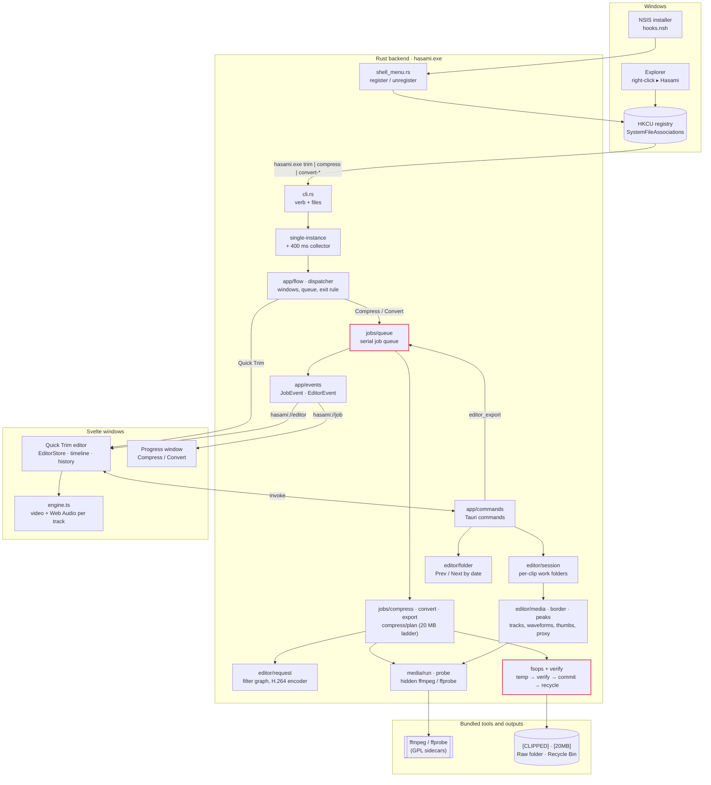
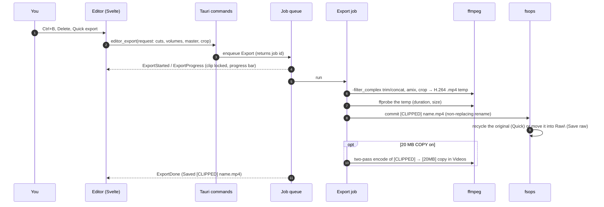

# Architecture

Hasami is one Tauri 2 app. A Rust backend owns every file and every ffmpeg run, and two
small Svelte windows (the Quick Trim editor and the progress window) talk to it through
Tauri commands and events. Click a box in either chart to open its source.

## Components

- **One process.** Every right-click launches `hasami.exe`. Later launches hand their files
  to the first one (single-instance), and a 400 ms collector turns a multi-select into one batch.
- **One queue.** Compress, Convert and editor exports run one at a time in `jobs/queue`, so
  encodes never fight over the GPU or disk. The app exits once no window is open and the queue is empty.
- **File safety.** Every output goes to a temp file, is checked with ffprobe, and only then is
  committed with a non-replacing rename. Originals are recycled or moved only after that, and
  nothing is ever deleted permanently (spec §8).

## A Quick export

See [design/specs](design/specs/2026-10-30-hasami-design.md) for the full behavior spec.
